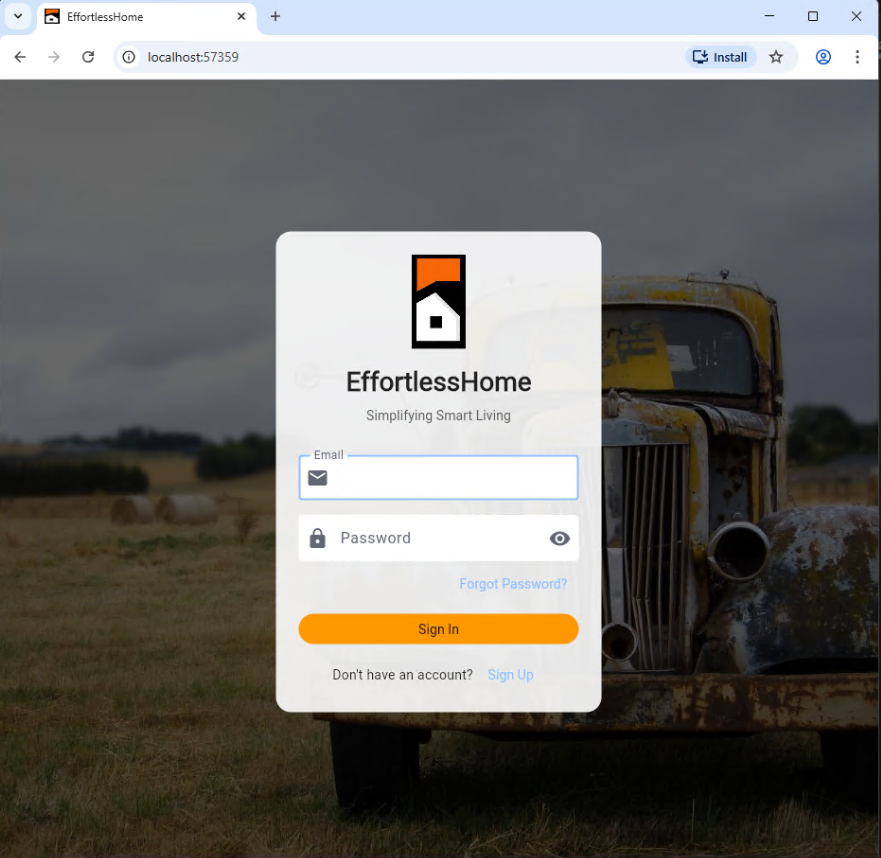
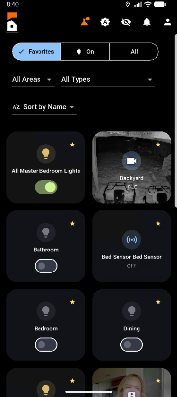
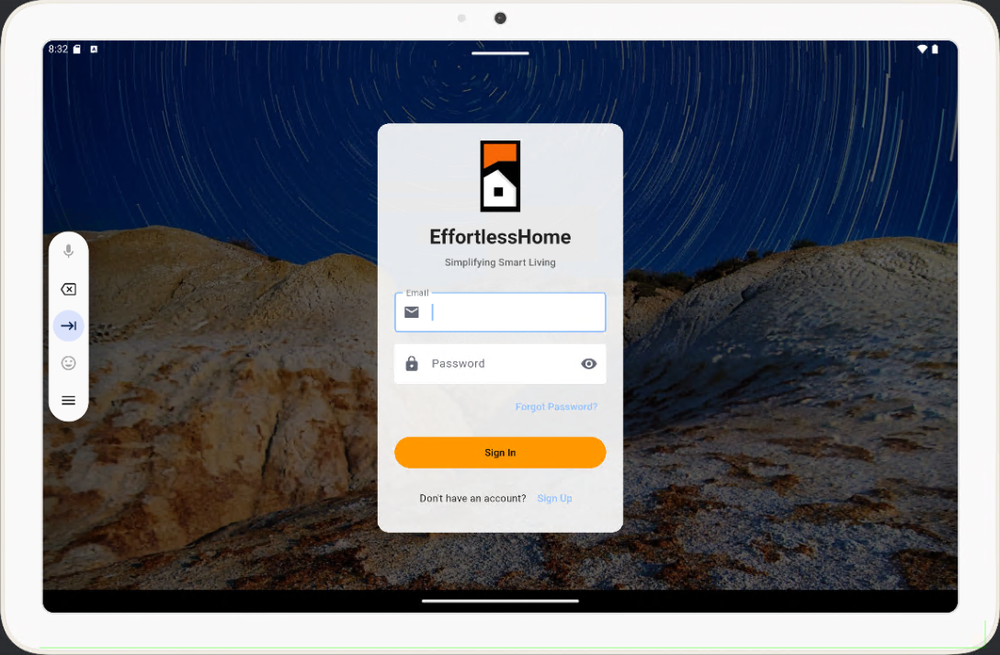
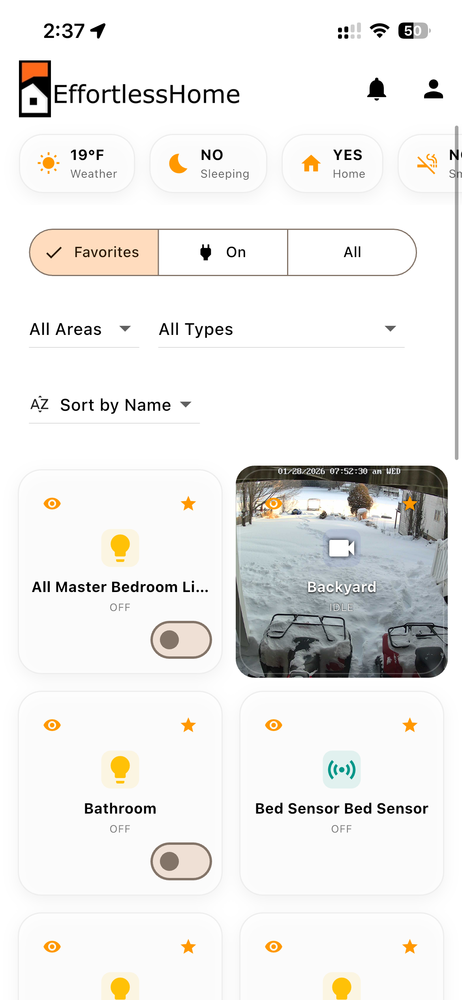
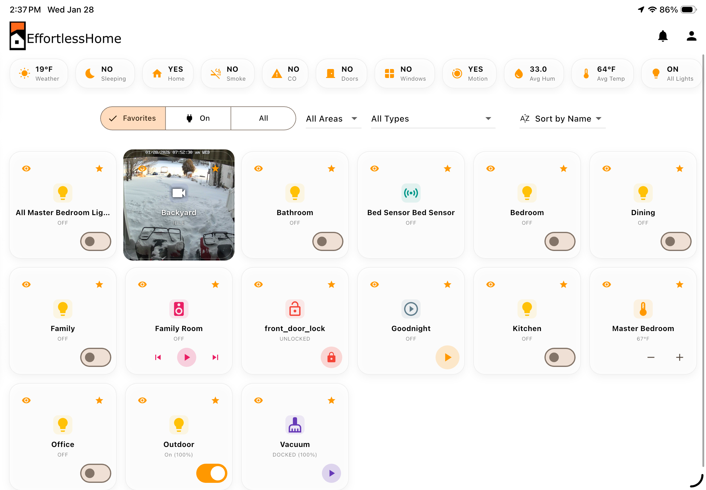
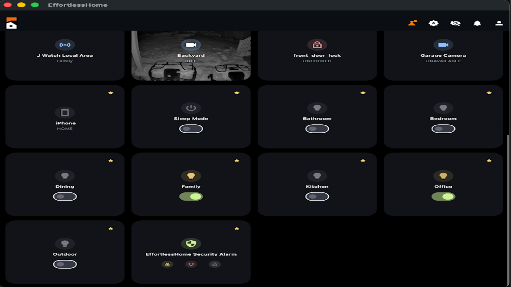
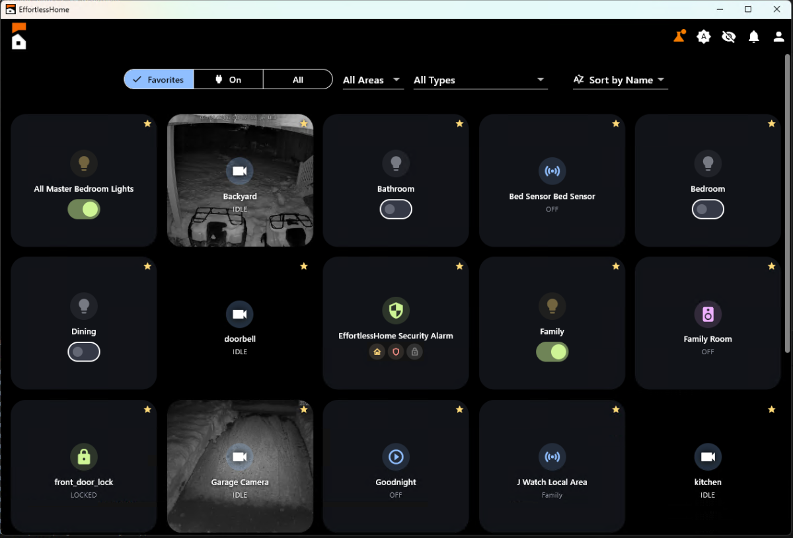

<div align="center">

# EffortlessHome

### Get more from Home Assistant. Spend less time working on it.

EffortlessHome adds a simpler household experience on top of the Home Assistant
you already run. This repository contains the Home Assistant integration that
connects your system to Effortless Home.

[](https://github.com/hacs/integration)
[](https://github.com/effortlesshome/effortlesshome)
[](LICENSE)

[Website](https://www.effortlesshome.co) · [Getting started](https://www.effortlesshome.co/getstarted/) · [Report an issue](https://github.com/effortlesshome/effortlesshome/issues)

[](https://my.home-assistant.io/redirect/hacs_repository/?owner=effortlesshome&repository=effortlesshome)

</div>

---

## What Effortless Home offers

Effortless Home is designed to work with your existing Home Assistant
installation, not replace it. The website describes a unified dashboard and
household app, remote access, guest access with selected device permissions,
cameras, Matter support, and entity management tools.

The website currently lists the iOS, Android, and TV apps as beta. Features and
available device states depend on your Home Assistant setup and Effortless Home
account. See [effortlesshome.co](https://www.effortlesshome.co) for current
product details and availability.

## What this integration adds

The integration links a Home Assistant system to your Effortless Home account
and provides Home Assistant entities, services, and supporting configuration
files. Available features include:

- A multi-mode alarm control panel and alarm status/event sensors.
- Automatically created convenience groups and area-related entities for
  supported sensors, lights, and covers.
- Presence, sleep, monitoring, safety, and smart-appliance entities and
  automations.
- 38 included automation blueprints for security, notifications, climate,
  lighting, routines, and device maintenance.
- EffortlessHome notification and location webhooks, plus the
  `notify.effortlesshome` notification service.
- Buttons and services for deploying the included blueprints, themes, and
  frontend files. On Home Assistant OS or Supervised, additional buttons can
  manage the EffortlessHome add-on.

The dashboard, apps, guest experience, remote access, cameras, and Matter
support are part of the wider Effortless Home service. They are not all
implemented by this integration alone.

## Screenshots

These screenshots show examples of the EffortlessHome interfaces. Mobile and TV
apps are currently in beta.

<details>
<summary><strong>Web</strong></summary>
<br/>

</details>

<details>
<summary><strong>Phone and tablet</strong></summary>
<br/>




</details>

<details>
<summary><strong>TV and desktop examples</strong></summary>
<br/>


</details>

## Installation

### HACS

1. Open HACS in Home Assistant.
2. Find **EffortlessHome**. If it is not listed, add
   `https://github.com/effortlesshome/effortlesshome` as a custom integration
   repository in HACS.
3. Install the integration and restart Home Assistant.

### Manual installation

1. Copy `custom_components/effortlesshome` from this repository into your
   Home Assistant `custom_components` directory.
2. Restart Home Assistant.
3. In **Settings > Devices & services**, select **Add integration** and search
   for **EffortlessHome**.

## Connect your system

The integration requires Home Assistant 2024.1.0 or later, the `recorder`
integration, an internet connection, and an Effortless Home account.

1. Add the integration from **Settings > Devices & services**.
2. Sign in with your Effortless Home account email and password.
3. Select an existing system, or create one by entering your Home Assistant URL
   and a Home Assistant long-lived access token. System creation also asks for
   an alarm PIN and system settings.
4. After setup, use **Configure** on the integration to edit system settings,
   including guest device permissions, alarm PIN, history retention, and
   temperature and humidity thresholds.

The password is used to sign in and is not stored by the integration. Firebase
authentication tokens are stored in the config entry; ID tokens are refreshed
automatically, and rotated refresh tokens are saved for future restarts. Treat
your Home Assistant access token as a secret.

### Optional EffortlessHome add-on

The integration can add the EffortlessHome add-on repository, install the
add-on, and start or stop it on Home Assistant OS and Supervised installations.
Use the corresponding buttons on the EffortlessHome integration device. These
buttons are only available when Home Assistant Supervisor is present. The
add-on is separate from this HACS integration.

The Effortless Home website describes remote access through Cloudflare Tunnel
infrastructure. Cloud-connected features require internet access and depend on
the Effortless Home service and your account.

## Included blueprints and frontend files

The integration does not install its supporting files automatically. To copy
the current EffortlessHome blueprints, themes, and frontend files into your
Home Assistant configuration, press **Deploy Latest EffortlessHome Config** on
the integration device or call `effortlesshome.deploy_latest_config`.

The blueprints are copied into Home Assistant's blueprint directory; they are
not enabled as automations automatically. Open **Settings > Automations &
Scenes > Blueprints** to create automations from them.

### Optional sidebar panels

The deployed frontend files can be exposed as Home Assistant sidebar panels
with `panel_custom`. This is optional; merge the following into your existing
`configuration.yaml` only if you want these panels. Do not duplicate existing
`homeassistant:` or `panel_custom:` keys.

```yaml
panel_custom:
  - name: effortlesshome-config-panel
    sidebar_title: EffortlessHome Config
    sidebar_icon: mdi:alpha-e-box-outline
    url_path: effortlesshome-config-panel
    module_url: /local/effortlesshome/config-panel.js

  - name: effortlesshome-area-panel
    url_path: effortlesshome-area-panel
    module_url: /local/effortlesshome/area-panel.js

  - name: effortlesshome-label-panel
    url_path: effortlesshome-label-panel
    module_url: /local/effortlesshome/label-panel.js
```

Restart Home Assistant after changing `configuration.yaml`.

## Services

The integration registers these Home Assistant services:

| Service | Purpose |
|---|---|
| `effortlesshome.create_event` | Create an event for an entity during an active alarm. |
| `effortlesshome.confirm_pending_alarm` | Confirm a pending alarm. |
| `effortlesshome.cancel_alarm` | Cancel an active or pending alarm. |
| `effortlesshome.get_alarm_status` | Retrieve the current alarm status. |
| `effortlesshome.update_entity` | Assign an entity to an area (`entity_id`, `area_id`). |
| `effortlesshome.add_label_to_entity` | Add a label to an entity (`entity_id`, `label`). |
| `effortlesshome.deploy_latest_config` | Copy the integration's current blueprints, themes, and frontend files into the Home Assistant configuration. |
| `effortlesshome.get_firebase_config` | Retrieve Firebase configuration for Home Assistant mobile app setup. |
| `notify.effortlesshome` | Send a notification to registered EffortlessHome devices; accepts `message` and optional `title` and `data`. |

## Cloud connection and pricing

Home Assistant remains on your hardware. The Effortless Home website explains
that the companion add-on connects the instance to the Effortless Home service,
and that some features use cloud services, including remote access and the
experience outside your local Home Assistant environment. Each system uses
its own authentication credentials and tokens.

At the time this README was updated, the website advertised a 30-day free trial
and a plan at $15/month or $150/year (USD). Check the
[website](https://www.effortlesshome.co) for current pricing and terms.

## Support

- [Getting started](https://www.effortlesshome.co/getstarted/)
- [Effortless Home website](https://www.effortlesshome.co)
- [Report an issue](https://github.com/effortlesshome/effortlesshome/issues)
